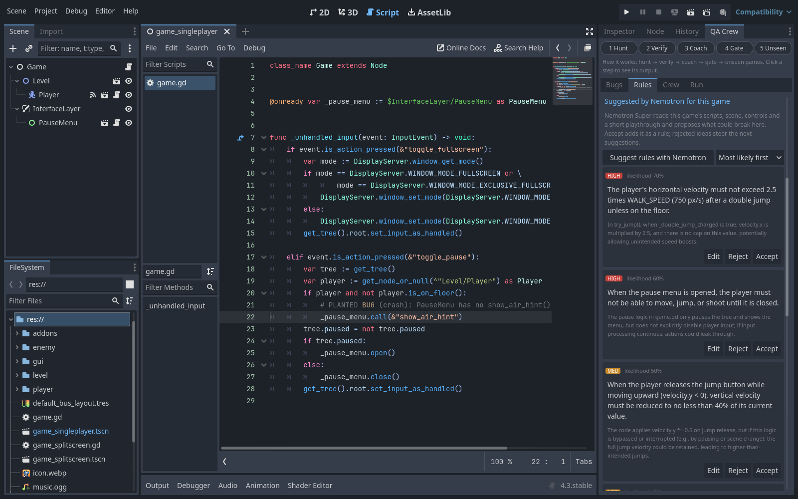
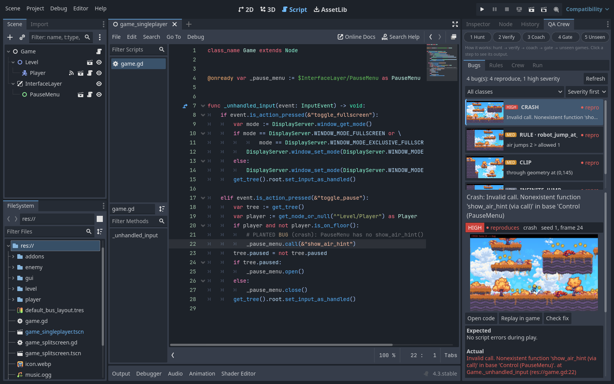
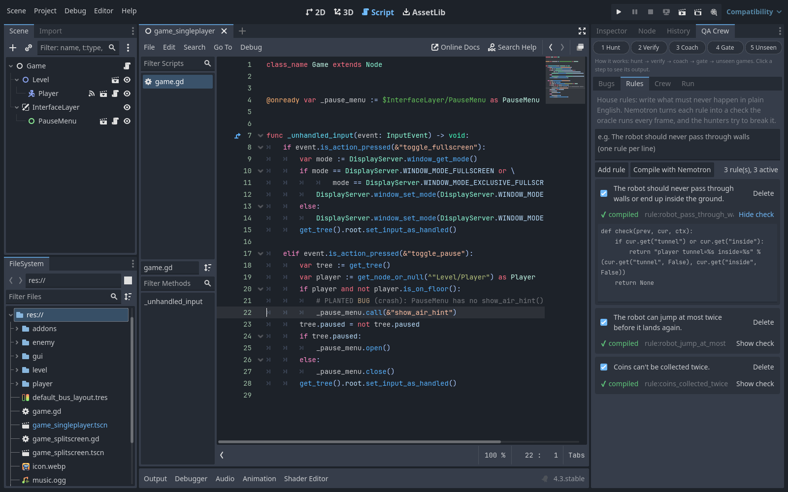
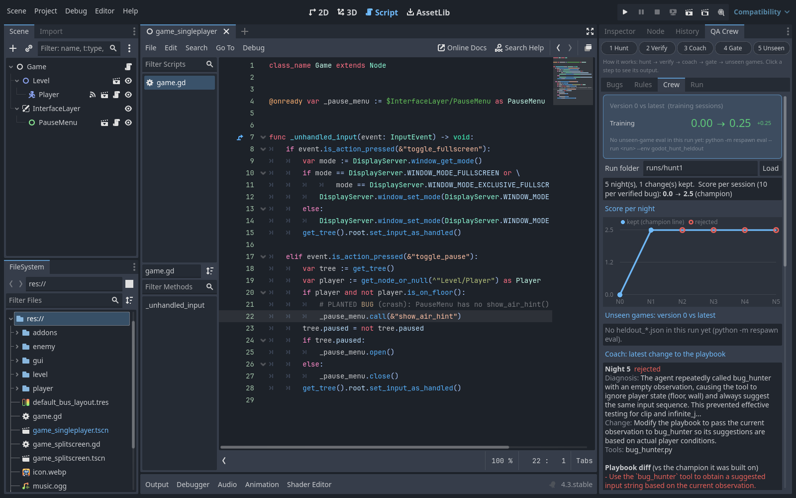
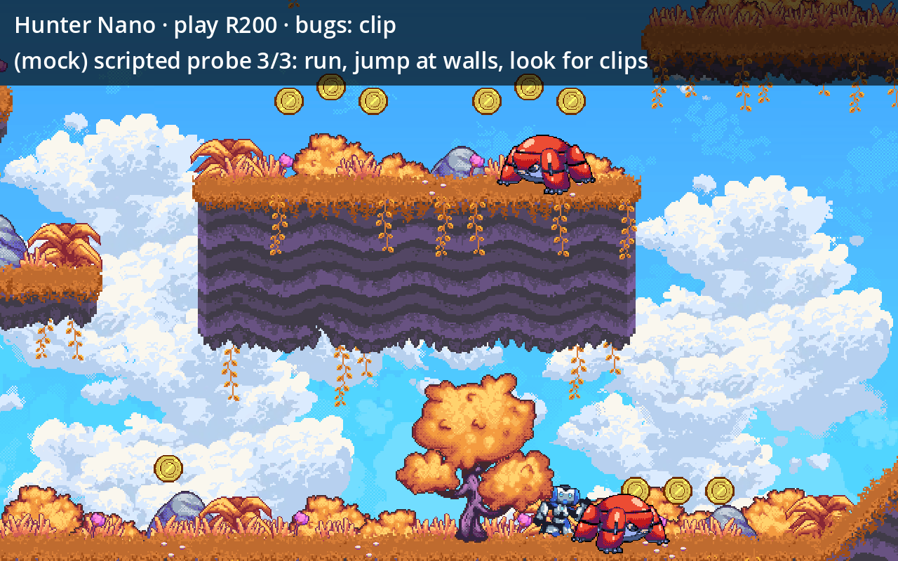

# Bug Hunters: a self-improving Nemotron QA crew for Godot games

Built at the Crusoe x Cerebral Valley **Recursive Agents Hackathon** (Oct 17, 2026), track **Version N+1**.
What is new and what is borrowed is spelled out in
[What we built today vs. what we used](#what-we-built-today-vs-what-we-used).

## What it does

A crew of small **NVIDIA Nemotron** models on **Crusoe Managed Inference** plays a real Godot game
through a plugin, tries to break it, and files **fix-ready bug reports**: a minimized replay, a GIF of
the failure, the game state at that frame, where to look in the code, and a command that turns green
once the bug is fixed.

Every night the crew **improves itself**: a Nemotron Super coach reads the day's play logs, then
rewrites the crew's testing playbook or **writes a new Python helper tool** for it (which must pass
its own test in a sandbox). A gatekeeper keeps the change only if the new crew finds more verified bugs
than the current best crew on paired sessions (bootstrap test), and the current best is re-tested every
night. Proof of improvement is measured on games and bug sets the crew **never trained on**.

| Role | Model (Crusoe) | Job |
|---|---|---|
| Hunters | `nvidia/NVIDIA-Nemotron-3-Nano-30B-A3B`, `nvidia/Nemotron-3.5-Lightning-30B-A3B` | Play the game via tool calls (`play("R30 RJ20 W1 J5")`, free helper tools) |
| Coach | `nvidia/NVIDIA-Nemotron-3-Super-120B-A12B` | Diagnose, then propose ONE change: playbook edit, new tool, or roles |
| Gatekeeper | code | Paired A/B on the same sessions; keep only significant gains |
| Oracle | code | Confirms bugs from the trace (no model can claim a bug that does not replay) |

Bug classes the oracle confirms: `crash` (GDScript error), `clip` (through/inside solid geometry),
`infinite_jump`, `out_of_bounds`, `dupe` (score above collectibles taken), `ghost_score` (score while dead),
plus the developer's own **house rules** (below).

### House rules: tell the crew what must never happen

Type rules in plain English in the dock's **Rules** tab ("The robot should never pass through walls",
"Coins can't be collected twice"). **Compile** has Nemotron Super write each one as a small Python check,
`def check(prev, cur, ctx)`, run by the oracle on every physics frame (position, velocity, floor/wall,
tunnel/inside flags; score, collectibles, bounds, the frame's events, and a per-rule memory). Before a check
is accepted it must pass a strict AST allowlist (no imports, no `while`, no dunders, a tiny builtins set),
stay silent on a recorded clean run (`respawn/envs/godot_rules_fixture.json`) and fire on its own violating
example; failures go back to the model with the error (up to 2 retries). The developer reviews the code in the
dock. QA hunts then show the hunters the rules to break, and a violation is a verified bug `rule:<id>` with
the same minimized replay, GIF, report and `qa check` as the built-in classes (the report keeps the rule's
code, so `check` judges the same rule later). Rules live in `res://qa_rules.json`; they apply to QA hunts
only, never to evolution or held-out scoring. `platformer_heldout` ships three compiled rules and a sample
rule report. CLI: `python -m respawn.qa rules compile|list|test|suggest --project <game>`.

**Suggest rules**: instead of typing generic rules, press *Suggest rules with Nemotron*: Super reads the game's
own scripts (our `# PLANTED BUG` markers are stripped), main scene, controls and a short bridge playthrough, and
proposes ~8 game-specific rules with a rationale citing the code, severity and likelihood
(`res://qa_rule_suggestions.json`; precomputed for both held-out games). Accept turns one into a rule (then
Compile), Edit tweaks it first, Reject greys it out. **N+1 here too:** past accepted and rejected suggestions go
back into the next prompt, so each round proposes kinds of rules the developer has not already judged.



## How the crew plays a Godot game

`godot/qa_crew/` is a Godot 4 addon:

- `qa_bridge.gd` (autoload): a local TCP JSON-lines server inside the game. `act` presses input actions
  for N physics frames and returns a per-frame trace (position, velocity, floor/wall, tunnelling
  and overlap checks against the physics space). The engine is **frozen between commands** and run with
  `--fixed-fps 60`, so a run is exactly reproducible from (seed, inputs). `map` samples a collision map,
  `screenshot`/`capture_every` save frames when the game runs on a virtual display (Xvfb).
- `plugin.cfg`, `qa_plugin.gd`, `qa_dock.gd`: the **QA Crew** editor dock (enabled in
  `platformer_heldout` and `dodge_heldout`, which ship sample reports in `qa_reports/`). A **How it works**
  strip on top (1 Hunt, 2 Verify, 3 Coach, 4 Gate, 5 Unseen) lights up the active stage during a hunt and
  jumps to each stage's output when clicked. Four tabs:
  - **Bugs**: every report in `res://qa_reports/` with a thumbnail, a severity badge (crash high; clip,
    out of bounds and house rules medium; others low), bug class and a "reproduces" mark, filterable by class
    and sorted by severity or newest. Each bug reads in plain English ("You can keep jumping in mid-air: 3 jumps before landing, but
    only 1 extra is allowed": what happened, how to see it, why it matters; written from templates, no LLM);
    the technical report sits under **Details for AI agents** with a *Copy report for an AI agent* button.
    Selecting one plays the failure animation (a sprite sheet of the GIF frames) and shows expected vs
    actual, the minimal repro, the state at failure and where to look. **Open code** jumps to the suspect
    script line, **Replay in game** runs the game in the editor and plays the exact repro at normal speed
    (the bridge reads `res://qa_reports/.replay.json` once, no TCP client needed), and **Check fix** re-runs
    the repro headless: green *Fixed* or red *Still reproduces*.
  - **Rules**: the game's house rules: add, enable/disable, delete, **Compile with Nemotron**, and review
    each rule's compiled check.
  - **Crew**: how the crew learned, in plain words first ("Your crew is on version 1. It now finds 1.42 real bugs
    per test run, up from 0.25", what it tries, its tools, night by night), with the raw genome, stats, tool code and
    playbook diff under **Details for AI agents**. Built from a run's files alone: a big version 0 vs latest card (unseen games
    when `heldout_*.json` exist), the coach's latest change with its playbook diff, and from `lineage.jsonl` score per night (filled dots = kept
    changes on the champion line, hollow = rejected candidates), each night's change and kept/rejected verdict with P(better), the tool code the coach wrote that night
    ("Night 1: the coach wrote tools/bug_hunter.py", diffed against the parent genome), and
    version 0 vs latest on unseen games when `heldout_*.json` files exist.
  - **Run**: Crusoe API key, crew folder, Python, genome and seeds, **Run QA crew**, a status line with a
    progress bar (sessions played, then findings verified) and a live log. When
    the run finishes the dock switches to Bugs.
  - **Watch live** (Run tab checkbox, or `python -m respawn.qa hunt --watch`): the first session plays in a
    visible game window at real time, captioned with the hunter's move, its reasoning and the bugs found so far;
    its moves also stream into the log in blue. Other sessions stay headless, and traces match a headless run.
    Try it offline: `python -m respawn.qa hunt --project godot/games/platformer_heldout --seeds 0 --mock --watch`.





- Optional `res://qa_crew.json` per game: player class, score location, collectibles, bounds, spawn
  points, key letters. Without it the crew guesses from the InputMap.

## Architecture

```
 Godot editor                                   Python crew runner (respawn/)                 Crusoe Managed Inference
 ┌──────────────────────────────┐   spawns     ┌───────────────────────────────────────┐      ┌──────────────────────────┐
 │ QA Crew dock (qa_dock.gd)    │ ───────────► │ qa.py hunt / rules / check            │      │ Hunters: Nemotron Nano,  │
 │  Bugs · Rules · Crew · Run   │ ◄─ stdout ── │ harness.py: one tool-calling loop per │ ◄──► │ Lightning (play + tools) │
 │  How-it-works stepper        │   reports    │   hunter, crew files = genome         │      │ Coach + rule writer:     │
 └──────────────────────────────┘              │ envs/godot_hunt.py: env + oracle      │      │ Nemotron Super           │
 ┌──────────────────────────────┐  TCP JSON    │ rules.py: house rules -> checks       │      └──────────────────────────┘
 │ Game + QA bridge autoload    │ ◄──────────► │ godot/client.py: launch game, bridge  │
 │ (qa_bridge.gd): act, state,  │  per-frame   │ qa.py: minimize, replay-verify, GIF,  │
 │ reset, map, screenshot; the  │  trace       │   plain-English + AI-agent report     │
 │ engine is frozen between     │              └───────────────────────────────────────┘
 │ commands: replays are exact  │                 Nightly loop (evolve.py)
 └──────────────────────────────┘                 play train sessions -> coach proposes ONE change
                                                  (playbook / new sandboxed tool) -> gate.py paired
                                                  bootstrap keeps it only if verified bugs rise ->
                                                  lineage.jsonl; stop after 3 blocked nights (--patience)
                                                  evaluate.py: version 0 vs latest on unseen games
```

- **Dock** (`godot/qa_crew/qa_dock.gd`, `qa_plugin.gd`): the UI. It runs the crew as a subprocess and reads its reports and lineage files.
- **Bridge** (`qa_bridge.gd`): an autoload inside the game. It presses input actions for N physics frames and returns a per-frame trace (position, velocity, floor and wall flags, tunnelling and overlap checks, score, errors). Fixed physics FPS and a frozen engine between commands make (seed, inputs) an exact replay. Watch live paces it to real time in a visible window.
- **Hunters** (`harness.py`): small Nemotron models play through `play("R30 RJ20 W5")` and free helper tools, which are Python files run in a sandbox (`sandbox.py`).
- **Oracle and house rules** (`envs/godot_hunt.py`, `rules.py`): code that confirms bugs from the trace. It covers the built-in classes plus plain-English rules that Nemotron Super compiles into checks. A model can't claim a bug that doesn't replay.
- **Replay verifier and reports** (`qa.py`): shrinks the input sequence, replays it to confirm the bug, records a GIF, and writes a plain-English report with a "Details for AI agents" section and a `check` command that passes once the bug is fixed.
- **Crew files (genome)** (`genome.py`): `playbook.md` + `tools/*.py` + `roles.json`, as shipped in `demo/genomes/`.
- **Coach, gate, lineage** (`coach.py`, `gate.py`, `evolve.py`): each night Super reads the logs and proposes one change. The gate runs it on the same paired sessions as the current best crew and keeps it only if it finds more verified bugs. Every decision is logged to `lineage.jsonl`.
- **Held-out test** (`evaluate.py`): compares the starting crew with the trained crew on games and bug sets the crew never trained on.

## Why Nemotron

One open model family covers every role, served from one Crusoe endpoint (prices in USD per 1M tokens: input / output / cached input):

| Role | Model | Why this one |
|---|---|---|
| Hunters (high volume) | Nemotron 3 Nano 30B-A3B, Nemotron 3.5 Lightning 30B-A3B | Mixture-of-experts with about 3B active parameters, fast and cheap enough for a call every half second of play ($0.05 / $0.20 / $0.03). NVIDIA describes Lightning as a sub-agent workhorse for long-running agents |
| Coach | Nemotron 3 Super 120B-A12B | 12B active; built for tool use and long-context reasoning, which is what reading a night of play logs needs ($0.30 / $2.40 / $0.15) |

- **Long agent loops:** Nemotron 3 is a hybrid Mamba-Transformer mixture-of-experts built for long-context agent work, and a hunter's context is a long, growing log of states and actions (262k context on Crusoe).
- **Cheap enough to evolve:** every candidate change is A/B tested over many sessions, and Crusoe's prefix caching bills the repeated system prompt, playbook and tool schemas at the cached rate.
- **Open weights, data and recipes:** every verified session is a trajectory that could fine-tune a Nemotron into a dedicated game tester the developer runs themselves.
- **Rate limits:** Crusoe limits requests per model, so giving each role its own Nemotron spreads the load.

## Layout

```
respawn/                 the Version N+1 loop (game-agnostic)
  llm.py                 Crusoe client: per-model RPM limiter, backoff, mock mode
  harness.py             one tool-calling loop per agent; free helper tools vs game actions
  coach.py  gate.py      dream coach; paired bootstrap gatekeeper
  evolve.py evaluate.py  nights loop with lineage; held-out evaluation
  sandbox.py             AST allowlist + isolated subprocess + rlimits for agent-written tools
  envs/godot_hunt.py     Godot bug-hunting env + oracle + replay verifier
  godot/client.py        launches Godot headless (or on Xvfb) and talks to the bridge
  godot/evidence.py      rendered replay -> GIF + snapshot
  qa.py                  hunt -> minimized, fix-ready reports; `check` command; `rules compile`
  rules.py               house rules: Nemotron-compiled per-frame checks, AST allowlist, fixture test
godot/qa_crew/           the Godot addon (bridge + editor dock)
godot/games/             games under test (upstream demos + our planted bugs)
runs/                    evolution runs (lineage.jsonl, genomes, trajectories)
```

## Run it

Requirements: Python 3.11+, Godot 4.3+ (tested on 4.3 Linux and 4.7.2 macOS; `GODOT_BIN`, default
`/opt/godot/Godot_v4.3-stable_linux.x86_64`), `pip install pillow`, and on a headless Linux box `xvfb-run`
for GIFs. Put `CRUSOE_API_KEY=...` in `.env` (never committed).

macOS: GIFs render in a real (briefly visible) game window, so no xvfb is needed. A Godot started from
Finder only sees the system `python3` (no Pillow), so set **Python** in the dock's Run tab to a venv with
Pillow, e.g. `<crew folder>/.venv/bin/python3` (picked up automatically when it exists).

```bash
# import assets once per game
$GODOT_BIN --headless --import --path godot/games/platformer_train

# evolve the crew on bug set A (train), 8 nights, 8 paired sessions per night
python -m respawn evolve --env godot_hunt --run runs/hunt2 --gens 10 --train 0-11   # stops early after 3 blocked nights
python -m respawn lineage --run runs/hunt1

# held-out: night-0 crew vs best crew on bug sets B and C (never seen in training)
python -m respawn eval --run runs/hunt1 --env godot_hunt_heldout --seeds 100-107
python -m respawn eval --run runs/hunt1 --env godot_hunt_dodge --seeds 100-107

# file fix-ready reports with the best crew, then verify a fix
python -m respawn.qa hunt --project godot/games/platformer_heldout --genome demo/genomes/gen_001 --seeds 0-3
python -m respawn.qa check qa_reports/<id>.json
```

`--mock` runs the whole loop offline with scripted players and coach.

## Results

Run 2 is the shipped demo crew (`demo/lineage.jsonl`, `demo/genomes/`; copied from `runs/hunt2`, 12 paired
sessions per night): on night 1 the coach wrote `tools/bug_explorer.py` (picks input sequences aimed at the bug
classes not found yet) and the gatekeeper kept it, training score 2.5 -> 14.2 points per session (11 wins, 0
losses, 1 tie on the paired sessions, P(better) 1.00). Two earlier night-1/2 attempts failed their own tool tests
before a restart. Nights 2 and 3 proposed rewrites of that tool that scored worse (-2.9 and -9.4 points per
session), and the gatekeeper blocked both, so the shipped crew keeps `bug_explorer.py`. Held-out, on Dodge the Creeps (bug set C, never trained on, 8 sessions): the trained crew
finds 0.875 verified bugs per session vs 0.375 for the starting crew (4 better, 0 worse, 4 tied; 90% CI of the
gain [+2.5, +7.5] points, P(better) 0.997; `demo/heldout_godot_hunt_dodge.md`). On the unseen platformer (bug set B,
8 sessions): 1.5 verified bugs per session vs 0.25 (8 better, 0 worse, 0 tied; 90% CI of the gain [+10, +15]
points, P(better) 1.0; `demo/heldout_godot_hunt_heldout.md`).

| Held-out game (never trained on) | Starting crew | Trained crew (run 2) | Sessions better / worse / tied |
|---|---|---|---|
| Platformer, bug set B | 0.25 bugs/session | **1.50** bugs/session | 8 / 0 / 0 |
| Dodge the Creeps, bug set C | 0.375 bugs/session | **0.875** bugs/session | 4 / 0 / 4 |

Run 1 (kept for honesty in `demo/run1/`: lineage, genomes and held-out files; 6 nights, 8 paired training sessions per night, score = 10 per verified bug):

- Night 0 (untrained crew): 0.0 per session on training bug set A.
- Night 1 **kept**: the coach wrote `tools/bug_hunter.py` (shown in the dock's Crew tab); training score 0.0 -> 2.5, P(better) 0.90.
- Nights 2-6 **rejected** by the gatekeeper (no gain on the paired sessions).

Held-out (games and bug sets never used in training), version 0 vs the trained crew, 8 sessions each:

**Platformer, bug set B**

| genome | change | held-out mean | per-seed |
|---|---|---|---|
| gen_000 | starting team | 2.5 | 0, 10, 0, 0, 0, 0, 10, 0 |
| gen_001 | Add a tool that, given the current observation, suggests a focused inp | 1.25 | 0, 0, 0, 10, 0, 0, 0, 0 |

gen_001 vs gen_000 on 8 unseen seeds: mean gain -1.25, 1W/2L/5T, 90% CI [-5.0, 2.5], bootstrap P(better) 0.193

**Dodge the Creeps, bug set C**

| genome | change | held-out mean | per-seed |
|---|---|---|---|
| gen_000 | starting team | 1.25 | 0, 0, 0, 0, 10, 0, 0, 0 |
| gen_001 | Add a tool that, given the current observation, suggests a focused inp | 0.0 | 0, 0, 0, 0, 0, 0, 0, 0 |

gen_001 vs gen_000 on 8 unseen seeds: mean gain -1.25, 0W/1L/7T, 90% CI [-3.75, 0.0], bootstrap P(better) 0.0

**What this shows, honestly:** the loop runs end to end on Nemotron (coach writes and tests a tool, the
gatekeeper accepts or rejects, every step is logged), but run 1's only kept change did **not** transfer.
The hunters started calling the new tool every turn and repeating its single suggestion, which happened
to work on 2 of the 8 training sessions. The held-out evaluation is what caught this overfitting. Run 2
uses 12 paired sessions per night to make a lucky acceptance less likely (results below if it finishes in time).

## What we built today vs. what we used

**Built at the hackathon (Oct 17, 2026), all commits from 10:45 AM PT onward:**

- `respawn/`: the whole self-improvement loop (Crusoe client, agent harness, coach, gatekeeper,
  sandbox, evolution and held-out evaluation, Godot bug-hunting env, bug oracle, replay verifier,
  GIF evidence, fix-ready report writer and `check` command).
- `godot/qa_crew/`: the Godot addon (QA bridge autoload and the QA Crew editor dock), copied into
  each game's `addons/qa_crew/`.
- Everything we changed inside `godot/games/`: the planted bug sets A, B and C (each marked
  `# PLANTED BUG`), `qa_crew.json` and `qa_rules.json` (house rules) files, sample `qa_reports/`, and the silent `music.ogg` that
  replaces the upstream platformer track.
- `docs/` screenshots, this README, `LICENSE` and `THIRD_PARTY_NOTICES.md`.

**Used, not written by us:**

- The games under `godot/games/`: Godot's official demos `2d/platformer` and `2d/dodge_the_creeps`
  (imported unmodified in commit `2bf155c`), and SlayHorizon's MIT 2D platformer with Pixel Frog's
  CC0 Pixel Adventure art for `pixel_*` (imported unmodified, then changed in later commits). Run
  `git diff <import-commit> -- godot/games/<game>` to see exactly what we added to each.
- Godot Engine, Pillow, and NVIDIA Nemotron models served by Crusoe Managed Inference.

Licenses and attributions for all of it are in [THIRD_PARTY_NOTICES.md](THIRD_PARTY_NOTICES.md).
Our own code is MIT ([LICENSE](LICENSE)).

## Credits

- Games under test: Godot Engine official demos, `2d/platformer` and `2d/dodge_the_creeps`, from
  [godotengine/godot-demo-projects](https://github.com/godotengine/godot-demo-projects) (MIT; Dodge the
  Creeps (c) 2017 KidsCanCode, MIT), with art by Kenney (CC0), music by HorrorPen (CC BY 3.0) and the
  Xolonium font (OFL 1.1). Full list in [THIRD_PARTY_NOTICES.md](THIRD_PARTY_NOTICES.md).
- Engine: [Godot Engine](https://godotengine.org) 4.3 (MIT).
- Models: NVIDIA Nemotron family, served by [Crusoe Managed Inference](https://crusoe.ai).
