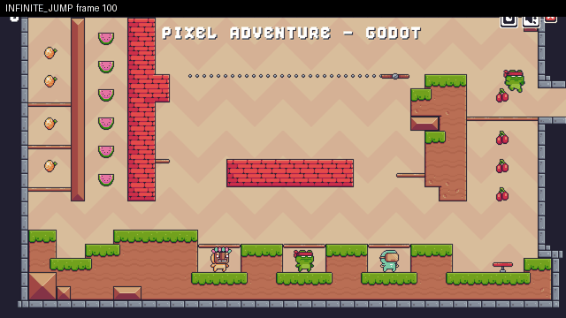

# Infinite jump: air jump #2 at (545,9)

**Class:** `infinite_jump`  **Game:** `/home/user/curosehack/godot/games/pixel_clean`  **Reproduces:** yes



**Expected:** At most the allowed number of mid-air jumps (double jump = 1) before touching the floor again.

**Actual:** air jump #2 at (545,9)

**Minimal repro** (seed 2, 6 play(s), shrunk from 6):
```
RJ20
R30 W5 J2
R20 RJ2
J10
J10
J10
```
**State at failure (frame 79):** `{"x": 549.45, "y": 63.24, "vx": 0.0, "vy": 326.67, "floor": false, "wall": false, "visible": true, "score": 1}`

**Look here first:** res://source/characters/player/player.gd: jump / double-jump recharge conditions

**Check (exit 0 = fixed):** `python -m respawn.qa check runs/clean_gen0/infinite_jump-629fb153.json`
