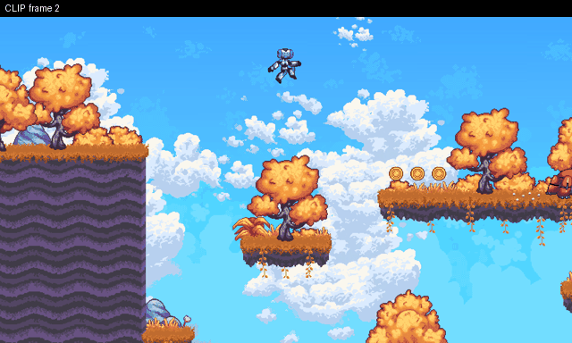

# The player went through solid ground after a hard landing at (0, 145).



**What happened:** The player's body moved into solid level geometry instead of stopping on it.

**How to see it:** Start the level from spawn point 8, then wait 0.6 s. Or press Replay in game.

**Why it matters:** Players can get stuck inside the level or fall through it.

## Details for AI agents

### Clip: through geometry at (0,145)

**Class:** `clip`  **Game:** `/home/user/curosehack/godot/games/platformer_heldout`  **Reproduces:** yes

**Expected:** The player body never passes through or overlaps solid level geometry.

**Actual:** through geometry at (0,145)

**Minimal repro** (seed 7, 1 play(s), shrunk from 2):
```
W66
```
**State at failure (frame 54):** `{"x": 0, "y": 145.38, "vx": 0, "vy": 0, "floor": true, "wall": false, "visible": true, "score": 0}`

**Look here first:** res://player/player.gd: movement code that sets position directly instead of using move_and_slide()

**Check (exit 0 = fixed):** `python -m respawn.qa check godot/games/platformer_heldout/qa_reports/clip-545d4178.json`
