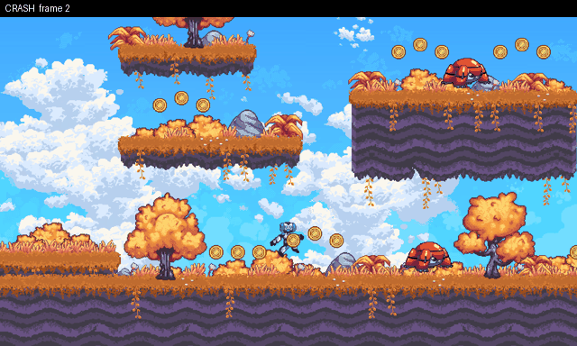

# The game hit a script error when you press Pause in mid-air.



**What happened:** Godot stopped running the script at game.gd line 22, so the rest of that code did not run. The error was: Invalid call. Nonexistent function 'show_air_hint (via call)' in base 'Control (PauseMenu)'.

**How to see it:** Start the level from spawn point 2, then hold Right for 0.2 s, then tap Jump, then press Pause. Or press Replay in game.

**Why it matters:** The game's code stops working mid-play, so players can lose their progress or get stuck.

## Details for AI agents

### Crash: Invalid call. Nonexistent function 'show_air_hint (via call)' in base 'Control (PauseMenu)

**Class:** `crash`  **Game:** `/home/user/curosehack/godot/games/platformer_heldout`  **Reproduces:** yes

**Expected:** No script errors during play.

**Actual:** Invalid call. Nonexistent function 'show_air_hint (via call)' in base 'Control (PauseMenu)'. at Game._unhandled_input (res://game.gd:22)

**Minimal repro** (seed 1, 1 play(s), shrunk from 1):
```
R20 J2 P2
```
**State at failure (frame 24):** `{"x": 332.02, "y": 624.38, "vx": 225, "vy": -396.5, "floor": false, "wall": false, "visible": true, "score": 1}`

**Look here first:** Game._unhandled_input (res://game.gd:22); res://player/player.gd: player logic

**Check (exit 0 = fixed):** `python -m respawn.qa check godot/games/platformer_heldout/qa_reports/crash-8a2994bb.json`
