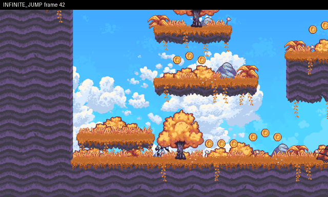

# Infinite jump: air jump #2 at (90,545)

**Class:** `infinite_jump`  **Game:** `/home/user/curosehack/godot/games/platformer_heldout`  **Reproduces:** yes



**Expected:** At most the allowed number of mid-air jumps (double jump = 1) before touching the floor again.

**Actual:** air jump #2 at (90,545)

**Minimal repro** (seed 0, 2 play(s), shrunk from 2):
```
W40
J6 W4 J6 W4 J2
```
**State at failure (frame 62):** `{"x": 90, "y": 545.17, "vx": 0, "vy": -707.5, "floor": false, "wall": false, "visible": true, "score": 0}`

**Look here first:** res://player/player.gd: jump / double-jump recharge conditions

**Check (exit 0 = fixed):** `python -m respawn.qa check godot/games/platformer_heldout/qa_reports/infinite_jump-88d5f90e.json`
