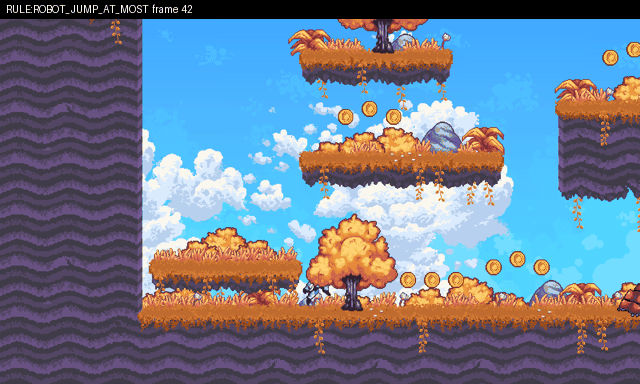

# Broke your rule: The robot can jump at most twice before it lands again.



**What happened:** The automatic check for this rule found: air jumps 2 > allowed 1.

**How to see it:** Start the level from spawn point 1, then wait 0.3 s, then tap Jump 3 times. Or press Replay in game.

**Why it matters:** You said this must never happen in your game.

## Details for AI agents

### House rule robot_jump_at_most: air jumps 2 > allowed 1

**Class:** `rule:robot_jump_at_most`  **Game:** `/home/user/curosehack/godot/games/platformer_heldout`  **Reproduces:** yes

**Expected:** House rule: The robot can jump at most twice before it lands again.

**Actual:** air jumps 2 > allowed 1

**Minimal repro** (seed 0, 2 play(s), shrunk from 2):
```
W40
J2 W2 J2 W2 J2
```
**State at failure (frame 50):** `{"x": 90, "y": 597.21, "vx": 0, "vy": -707.5, "floor": false, "wall": false, "visible": true, "score": 0}`

**Look here first:** res://player/player.gd: the game logic this house rule is about

**Check (exit 0 = fixed):** `python -m respawn.qa check godot/games/platformer_heldout/qa_reports/rule-robot_jump_at_most-46a5c333.json`
